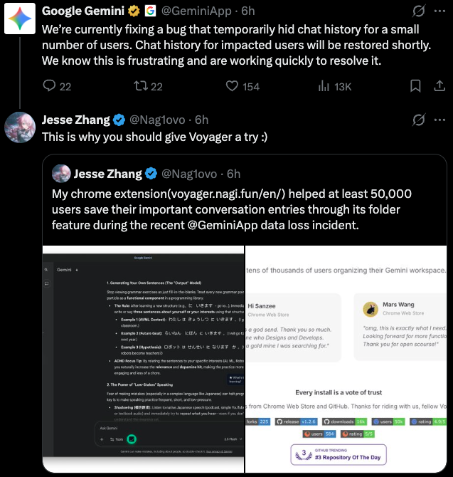

<div align="center">
  
  <h3>Сделайте свой опыт работы с ИИ по-настоящему своим ✨</h3>
  <p>
    <b>Gemini · Claude · ChatGPT · DeepSeek — наконец, всё в одном месте.</b>
  </p>

  <p>
    
    
    
    
    <a href="https://chromewebstore.google.com/detail/iifacdnjakkhjjiengaffnegbndgingi?utm_source=github&utm_medium=readme&utm_campaign=organic_growth&utm_content=ru" target="_blank"></a>
    <a href="https://chromewebstore.google.com/detail/iifacdnjakkhjjiengaffnegbndgingi?utm_source=github&utm_medium=readme&utm_campaign=organic_growth&utm_content=ru" target="_blank"></a>
    <a href="https://microsoftedge.microsoft.com/addons/detail/voyager/gibmkggjijalcjinbdhcpklodjkhhlne" target="_blank"></a>
    <a href="https://addons.mozilla.org/firefox/addon/gemini-voyager/" target="_blank"></a>
    <a href="https://addons.mozilla.org/firefox/addon/gemini-voyager/" target="_blank"></a>
  </p>

  <p>
    <a href="https://trendshift.io/repositories/16094" target="_blank"></a>
    <a href="https://www.star-history.com/voyager-crew/voyager" target="_blank">
     <picture>
       <source media="(prefers-color-scheme: dark)" srcset="https://api.star-history.com/badge?repo=voyager-crew/voyager&type=rank&theme=dark" />
       <source media="(prefers-color-scheme: light)" srcset="https://api.star-history.com/badge?repo=voyager-crew/voyager&type=rank" />
       
     </picture>
    </a>
    <a href="https://www.producthunt.com/products/gemini-voyager?embed=true&amp;utm_source=badge-featured&amp;utm_medium=badge&amp;utm_campaign=badge-gemini-voyager" target="_blank" rel="noopener noreferrer"></a>
  </p>
</div>

<p align="center">
  <a href="https://voyager.nagi.fun/ru">📖 Документация</a> • 
  <a href="../README.md">English</a> • 
  <a href="./README_ZH.md">简体中文</a> •
  <a href="./README_ZH_TW.md">繁體中文</a> •
  <a href="./README_JA.md">日本語</a> •
  <a href="./README_FR.md">Français</a> •
  <a href="./README_ES.md">Español</a> •
  <a href="./README_PT.md">Português</a> •
  <a href="./README_AR.md">العربية</a> •
  <a href="./README_KO.md">한국어</a>
</p>

<p align="center">
  
</p>

<!-- <p align="center">
    
  </p> -->

> [!NOTE]
> Если Voyager вам полезен, поделитесь им в X, Reddit, YouTube, Threads и т. д. Каждый репост помогает большему числу людей узнать о проекте. Спасибо.

---

## 👋 Почему Voyager?

Мы любим ИИ-чатботов, но иногда хочется, чтобы в них было чуть больше структуры.

Поэтому я создал **Voyager**. Это спутник, который помогает держать ваши разговоры с ИИ в порядке, под рукой и под контролем — будь то Gemini, Claude, ChatGPT или DeepSeek. Если вы исследователь, который ведёт десятки веток, разработчик, сохраняющий фрагменты кода, или просто любитель порядка, Voyager создан для вас.

<p align="center">
  <a href="https://x.com/Nag1ovo/status/2024509398601597412?s=20" target="_blank">
    
  </a>
  <br>
  <i>Во время сбоя 18 февраля, когда приложение Google Gemini сделало исторические разговоры некоторых пользователей недоступными, пользователи Voyager по-прежнему видели сохранённые разговоры в своих папках.</i>
</p>

---

## ✨ Возможности

### 🌌 Основное (Gemini и AI Studio)

- **📂 [Организация по папкам](https://voyager.nagi.fun/ru/guide/folders)**: группируйте чаты в двухуровневую иерархию папок с перетаскиванием.
  - **Gemini**: поддерживаются **режим изоляции аккаунтов** и **пользовательские цвета папок**.
- **💡 [Хранилище промптов](https://voyager.nagi.fun/ru/guide/prompts)**: сохраняйте промпты и повторно используйте их в Gemini, AI Studio и на [любых сайтах](https://voyager.nagi.fun/ru/guide/prompts#доступно-везде).
- **☁️ [Облачная синхронизация](https://voyager.nagi.fun/ru/guide/cloud-sync)**: синхронизируйте папки и промпты через Google Drive или через iCloud в Safari.
- **🗑️ [Пакетное удаление](https://voyager.nagi.fun/ru/guide/batch-delete)**: массовое удаление разговоров.
- **📐 [Копирование формул](https://voyager.nagi.fun/ru/guide/formula-copy)**: нажмите на формулу, чтобы скопировать её как LaTeX, MathML (Word) или математику для Notion.
- **🌦️ Визуальные эффекты**: добавьте сезонную атмосферу — **снег**, **кинематографический дождь** или **падающие лепестки сакуры** — в панели настроек.

### ✨ Эксклюзивно для Gemini

- **📍 [Навигация по таймлайну](https://voyager.nagi.fun/ru/guide/timeline)**: визуальные узлы для перехода между сообщениями, отметки важных моментов и управление ветками разговора.
- **💾 [Экспорт чатов](https://voyager.nagi.fun/ru/guide/export)**: экспорт разговоров в JSON, Markdown, PDF или изображение, с включёнными картинками.
- **🧜‍♀️ [Рендеринг Mermaid](https://voyager.nagi.fun/ru/guide/mermaid)**: автоматический рендеринг блок-схем, диаграмм последовательностей и других диаграмм Mermaid.
- **📝 [Исправление рендеринга Markdown](https://voyager.nagi.fun/ru/guide/markdown-fix)**: автоматически исправляет жирный шрифт Markdown, который ломают HTML-элементы, вставляемые Gemini.
- **🍌 [Image Refinement](https://voyager.nagi.fun/ru/guide/nanobanana)**: удаление водяных знаков без потери качества для изображений, созданных Gemini.
- **🔬 [Deep Research](https://voyager.nagi.fun/ru/guide/deep-research)**: извлечение процессов размышлений и ссылок на источники из сессий Deep Research.
- **🛠️ Полезные инструменты**:
  - **[Ответ с цитированием](https://voyager.nagi.fun/ru/guide/quote-reply)**: отвечайте с контекстом, выделив текст.
  - **[Предотвращение автопрокрутки](https://voyager.nagi.fun/ru/guide/prevent-auto-scroll)**: блокирует нежелательный прыжок страницы при отправке промпта клавишей Enter.
  - **[Сворачивание ввода](https://voyager.nagi.fun/ru/guide/input-collapse)**: поле ввода, которое разворачивается по необходимости, даёт больше места для чтения.
  - **[Модель по умолчанию](https://voyager.nagi.fun/ru/guide/default-model)**: сделайте любимую модель моделью по умолчанию.

### 🔌 Claude, ChatGPT и DeepSeek

Эти функции работают на основе [движка плагинов Voyager](https://voyager.nagi.fun/ru/plugins) и расширяют ваш опыт за пределы Gemini. Включите их в всплывающем окне расширения и предоставьте доступ к каждому сайту:

- **📍 Timeline**: тот же таймлайн со звёздочками и поиском в Claude и ChatGPT; у DeepSeek он доступен как необязательный плагин.
- **📂 Папки ChatGPT**: раскладывайте разговоры ChatGPT по папкам. Включено по умолчанию.
- **💾 Экспорт ChatGPT**: экспорт разговора ChatGPT в Markdown, JSON, PDF или изображение.
- **📐 Копирование формул**: нажмите на формулу, чтобы скопировать её LaTeX в Claude, ChatGPT и DeepSeek.
- **⌨️ Vim-ввод**: модальное редактирование и перемещение курсора в стиле Vim в полях ввода Claude, ChatGPT и DeepSeek.
- **📖 Удобная ширина чтения**: настройка ширины чата для комфортного чтения в Claude, ChatGPT и DeepSeek.
- **💬 Полезные мелочи**: ответы с цитированием, отправка по Ctrl/⌘+Enter и счётчик черновика в Claude, ChatGPT и DeepSeek; автосохранение черновика в Claude и DeepSeek.
- **🈶 Исправление CJK**: исправление отображения иероглифов CJK в Claude.
- **📜 Перенос кода**: в DeepSeek длинные строки кода прокручиваются по горизонтали, а не переносятся, поэтому отступы сохраняются.

### 🧩 Любой сайт — даже localhost

Добавьте любой сайт во всплывающем окне, и Менеджер промптов последует за вами туда, включая локальные приложения. Вот он внутри [DeepSeek Harness](https://github.com/deepseek-ai/deepseek-harness) на `localhost:3080`:

<p align="center">
  
</p>

### 🎨 Персонализация

- Откройте всплывающее окно расширения и найдите **Визуальные эффекты**, чтобы переключаться между `Off`, `Snow`, `Sakura` и `Rain`.
- Эффекты отображаются как лёгкие полноэкранные наложения и не блокируют взаимодействие со страницей.
- При переключении или отключении эффекта частицы плавно уходят, а не исчезают резко.

---

## 📥 Установка

> ⚠️ Примечание: Менеджер промптов — единственная функция, которая поддерживает Gemini для Enterprise.

<div align="center">
  <a href="https://chromewebstore.google.com/detail/iifacdnjakkhjjiengaffnegbndgingi?utm_source=github&utm_medium=readme&utm_campaign=organic_growth&utm_content=ru" target="_blank">
    
  </a>
  &nbsp;&nbsp;
  <a href="https://microsoftedge.microsoft.com/addons/detail/voyager/gibmkggjijalcjinbdhcpklodjkhhlne" target="_blank"></a>
  &nbsp;&nbsp;
  <a href="https://addons.mozilla.org/firefox/addon/gemini-voyager/" target="_blank">
    
  </a>
  &nbsp;&nbsp;
  <a href="https://github.com/voyager-crew/voyager/releases/latest/" target="_blank">
    
  </a>
</div>

<p align="center">
  <sub><b>Пользователям Edge:</b> Voyager по-прежнему поддерживается в Edge Add-ons для тех, кому нужен Edge на телефоне или планшете. Если проверка задерживается, Chrome Web Store и ручные пакеты GitHub остаются доступны.</sub>
</p>

Для **ручной установки** или **сборок для разработки** обратитесь к [руководству по установке](https://voyager.nagi.fun/ru/guide/installation).

---

## ☕ Поддержать проект

<div align="center">
  <a href="https://github.com/voyager-crew/voyager">
    
  </a>
</div>

Если Voyager делает вашу жизнь проще, можно угостить меня кофе. Это помогает выпускать новые обновления! Спонсоры будут указаны в разделе «Особая благодарность». ❤️

<div align="center">
  <a href="https://www.buymeacoffee.com/Nag1ovo" target="_blank">
    
  </a>
  <a href="https://github.com/sponsors/Nagi-ovo" target="_blank">
    
  </a>

  <p><b>Или поддержите через WeChat / Alipay / Afdian:</b></p>
  <table align="center" border="0" cellpadding="0" cellspacing="0">
    <tr>
      <td align="center">
        <br>
        <sub><b>WeChat Pay</b></sub>
      </td>
      <td align="center">
        <br>
        <sub><b>Alipay</b></sub>
      </td>
      <td align="center">
        <a href="https://afdian.com/a/nagi-ovo" target="_blank">
          <picture>
            <source media="(prefers-color-scheme: dark)" srcset="https://afdian-connect.vercel.app/profile.svg?slug=nagi-ovo&bg_color=%230d1117&text_color=%23dedbd7&border_color=%232e343d" />
            <source media="(prefers-color-scheme: light)" srcset="https://afdian-connect.vercel.app/profile.svg?slug=nagi-ovo" />
            
          </picture>
        </a><br>
        <sub><b>Afdian</b></sub>
      </td>
    </tr>
  </table>
</div>

### 🎙️ Рекомендуемый инструмент: Typeless

Я настоятельно рекомендую **[Typeless (typeless.com)](https://www.typeless.com/?via=gemini-voyager)** — ИИ-инструмент для превращения голоса в текст, которым я активно пользовался во время разработки Voyager. Его использование в ежедневной работе сэкономило мне огромное количество времени и заметно повысило продуктивность.

> 🎁 **[Регистрация по моей реферальной ссылке](https://www.typeless.com/?via=gemini-voyager)** (код: _`gemini-voyager`_) даёт **$5 бесплатных кредитов**. Это также даёт мне кредиты на поддержку проекта — бесплатный способ поддержать мою работу! ❤️

---

## 💬 Сообщество

<table>
  <tr>
    <td align="center" width="50%" valign="top">
      <a href="https://x.com/Nag1ovo/status/2012610584722731188" target="_blank">
        
      </a>
      <br><br>
      <b>Подписывайтесь на обновления</b><br>
      <sub>Следите за последними новостями.</sub>
    </td>
    <td align="center" width="50%" valign="top">
      <a href="https://discord.gg/TEUFxdMbGb" target="_blank">
        
      </a>
      <br><br>
      <b>Присоединяйтесь к сообществу</b><br>
      <sub>Общайтесь с другими пользователями, делитесь промптами и получайте помощь.</sub>
    </td>
  </tr>
</table>

---

## 🤝 Участие в разработке

[](https://deepwiki.com/voyager-crew/voyager)

Мы будем рады любому вкладу! Сообщайте об ошибках, предлагайте функции, улучшайте документацию или присылайте код:

- **Issues**: только воспроизводимые ошибки — используйте шаблон [отчёта об ошибке](https://github.com/voyager-crew/voyager/issues/new?template=bug_report.yml)
- **Discussions**: [запросы функций, идеи и вопросы](https://github.com/voyager-crew/voyager/discussions) — публикуйте их здесь, а не в Issues
- **Pull Requests**: правила см. в [CONTRIBUTING.md](./CONTRIBUTING.md)

<details>
<summary>Настройка среды разработки</summary>

```bash
# Установка зависимостей (скрипты работают на Bun; CI использует Bun 1.3.12)
bun i

# Режим разработки (с автоперезагрузкой)
bun run dev:chrome   # Chrome и браузеры на Chromium
bun run dev:firefox  # Firefox
bun run dev:safari   # Safari (требуется macOS)

# Сборки для публикации
bun run build:chrome   # Chrome
bun run build:edge     # пакет Edge (отдельно)
bun run build:firefox  # Firefox
bun run build:safari   # Safari
bun run build:all      # Chrome + Firefox + Safari
```

**Разработка для Safari**: выполните `bun run build:safari`, затем откройте отслеживаемый в репозитории проект Xcode в папке `Voyager/`.

</details>

Спасибо, что помогаете делать Voyager лучше! ❤️

### ❤️ Особая благодарность

Особая благодарность всем участникам за их вклад в Voyager ❤️

<a href="https://github.com/voyager-crew/voyager/graphs/contributors">
  
</a>

---

## 🌟 Благодарности

> Voyager — небольшой личный проект. Я предпочитаю тратить время на то, что помогает людям, а не на пути миграции, созданные для того, чтобы увести пользователей из других расширений.

- **[ChatGPT Conversation Timeline](https://github.com/Reborn14/chatgpt-conversation-timeline)** — оригинальное расширение для таймлайна ChatGPT, которое вдохновило этот проект.

- **[gemini-watermark-remover](https://github.com/journey-ad/gemini-watermark-remover) / [GeminiWatermarkTool](https://github.com/allenk/GeminiWatermarkTool)** — Image Refinement адаптирован на основе этих проектов. Сохранённые сторонние MIT-уведомления доступны в [THIRD_PARTY_NOTICES.md](../THIRD_PARTY_NOTICES.md).

- **[Gemini Helper](https://greasyfork.org/scripts/558318-gemini-helper)** — логика фиксации модели по умолчанию включает идеи взаимодействия, адаптированные из Gemini Helper, с указанием авторства в исходном коде.

- **[cordis](https://github.com/cordiverse/cordis)** — реестр побочных эффектов рантайма плагинов (`PluginScope`) заимствует из модели fiber у cordis дизайн жизненного цикла эффектов и их освобождения.

## 🌍 Экосистема

Проекты, вдохновлённые Voyager:

Если ваш проект вдохновлён Voyager, сделан его форком или построен на его основе, расскажите о нём в [Discussions](https://github.com/voyager-crew/voyager/discussions), и мы добавим его сюда.

- **[DeepSeek Voyager](https://github.com/Azurboy/deepseek-voyager)** — форк Voyager, адаптированный для DeepSeek, который приносит навигацию по таймлайну и управление чатами пользователям DeepSeek!

- **[claude-nexus](https://github.com/Qiuner/claude-nexus)** — расширение для улучшения Claude.ai, вдохновлённое Voyager: навигация по таймлайну, управление папками, библиотека промптов и многое другое, с полной совместимостью импорта и экспорта промптов с Voyager!

- **[Better_Doubao](https://github.com/Rex16200513/Better_Doubao)** — продвинутое расширение браузера, которое усиливает Doubao функциями навигации, организации и продуктивности.

- **[DeepSeek Enhancer](https://github.com/dlshuangchenyue1210/DeepSeek-Enhancer)** — расширение для веб-приложения DeepSeek, вдохновлённое Voyager: многоуровневые папки, экспорт чатов, копирование формул, резервное копирование данных и многое другое.

---

## 📄 Лицензия

Voyager распространяется под лицензией **GPL-3.0**.
Сохранённые сторонние MIT-уведомления для кода и ресурсов Image Refinement доступны в [THIRD_PARTY_NOTICES.md](../THIRD_PARTY_NOTICES.md).

Gemini — товарный знак Google LLC. Claude — товарный знак Anthropic, PBC. ChatGPT — товарный знак OpenAI, Inc. Voyager — независимый проект, он не связан с этими компаниями и не одобрен и не спонсируется ими.

---

<div align="center">
  <a href="https://www.star-history.com/#voyager-crew/voyager&type=date&legend=top-left">
   <picture>
     <source media="(prefers-color-scheme: dark)" srcset="https://api.star-history.com/svg?repos=voyager-crew/voyager&type=date&theme=dark&legend=top-left" />
     <source media="(prefers-color-scheme: light)" srcset="https://api.star-history.com/svg?repos=voyager-crew/voyager&type=date&legend=top-left" />
     
   </picture>
  </a>
  <p>Сделано с ❤️ Jesse Zhang</p>
  <sub>GPLv3 License © 2026</sub>
</div>
