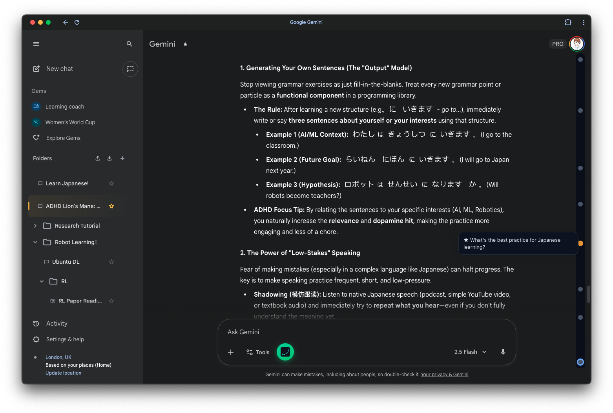

<div align="center">
  
  <h3>打造屬於你的 AI 體驗 ✨</h3>
  <p>
    <b>Gemini · Claude · ChatGPT · DeepSeek，終於完整了。</b>
  </p>

  <p>
    
    
    
    
    <a href="https://chromewebstore.google.com/detail/iifacdnjakkhjjiengaffnegbndgingi?utm_source=github&utm_medium=readme&utm_campaign=organic_growth&utm_content=zh_tw" target="_blank"></a>
    <a href="https://chromewebstore.google.com/detail/iifacdnjakkhjjiengaffnegbndgingi?utm_source=github&utm_medium=readme&utm_campaign=organic_growth&utm_content=zh_tw" target="_blank"></a>
    <a href="https://microsoftedge.microsoft.com/addons/detail/voyager/gibmkggjijalcjinbdhcpklodjkhhlne" target="_blank"></a>
    <a href="https://addons.mozilla.org/firefox/addon/gemini-voyager/" target="_blank"></a>
    <a href="https://addons.mozilla.org/firefox/addon/gemini-voyager/" target="_blank"></a>
  </p>

  <p>
    <a href="https://trendshift.io/repositories/16094" target="_blank"></a>
    <a href="https://www.star-history.com/voyager-crew/voyager" target="_blank">
     <picture>
       <source media="(prefers-color-scheme: dark)" srcset="https://api.star-history.com/badge?repo=voyager-crew/voyager&type=rank&theme=dark" />
       <source media="(prefers-color-scheme: light)" srcset="https://api.star-history.com/badge?repo=voyager-crew/voyager&type=rank" />
       
     </picture>
    </a>
    <a href="https://www.producthunt.com/products/gemini-voyager?embed=true&amp;utm_source=badge-featured&amp;utm_medium=badge&amp;utm_campaign=badge-gemini-voyager" target="_blank" rel="noopener noreferrer"></a>
  </p>
</div>

<p align="center">
  <a href="https://voyager.nagi.fun/zh_TW">📖 文件</a> •
  <a href="../README.md">English</a> • 
  <a href="./README_ZH.md">简体中文</a> •
  <a href="./README_JA.md">日本語</a> •
  <a href="./README_FR.md">Français</a> •
  <a href="./README_ES.md">Español</a> •
  <a href="./README_PT.md">Português</a> •
  <a href="./README_RU.md">Русский</a> •
  <a href="./README_AR.md">العربية</a> •
  <a href="./README_KO.md">한국어</a>
</p>

<p align="center">
  
</p>

<!-- <p align="center">
    
  </p> -->

> [!NOTE]
> 如果 Voyager 有幫助，歡迎分享到 X、Facebook、YouTube、Threads、Dcard 等等。每一次分享都能讓更多人看見這個專案。謝謝。

---

## 👋 為什麼要做 Voyager？

我們熱愛 AI 聊天機器人，但有時也希望它們能再多一點結構。

這就是我開發 **Voyager** 的原因。它是一個夥伴，幫助你讓 AI 對話保持有序、隨手可得，並更有效率——無論你使用的是 Gemini、Claude、ChatGPT 還是 DeepSeek。如果你是同時處理幾十條對話線索的研究者、會收藏程式碼片段的開發者，或只是喜歡井然有序的人，Voyager 都是為你準備的。

<p align="center">
  <a href="https://x.com/Nag1ovo/status/2024509398601597412?s=20" target="_blank">
    
  </a>
  <br>
  <i>在 2 月 18 日 Google Gemini App 導致部分使用者的歷史對話無法存取的事件中，Voyager 的使用者仍然能在資料夾中看到已儲存的對話。</i>
</p>

---

## ✨ 功能特色

<div align="center">
  
</div>

如需完整功能介紹，請造訪我們的[官方文件](https://voyager.nagi.fun/zh_TW)。

### 🌌 核心功能（Gemini 與 AI Studio）

- **📂 [資料夾整理](https://voyager.nagi.fun/zh_TW/guide/folders)**：將對話整理到最多三層的資料夾階層中，支援拖放操作。
  - **Gemini**：支援 **帳號隔離模式** 與 **自訂資料夾顏色**。
- **💡 [提示詞寶庫](https://voyager.nagi.fun/zh_TW/guide/prompts)**：在 Gemini、AI Studio 以及[自訂網站](https://voyager.nagi.fun/zh_TW/guide/prompts#任何網站皆可使用)中儲存並重複使用提示詞。
- **☁️ [雲端同步](https://voyager.nagi.fun/zh_TW/guide/cloud-sync)**：透過 Google 雲端硬碟同步資料夾與提示詞，Safari 上則可使用 iCloud。
- **🗑️ [批次刪除](https://voyager.nagi.fun/zh_TW/guide/batch-delete)**：一次批次刪除多則對話。
- **📐 [公式複製](https://voyager.nagi.fun/zh_TW/guide/formula-copy)**：點擊公式即可將它複製為 LaTeX、MathML（Word）或適用於 Notion 的數學格式。

### ✨ Gemini 專屬功能

- **📍 [時間軸導覽](https://voyager.nagi.fun/zh_TW/guide/timeline)**：以視覺化節點在訊息間跳轉、為重要時刻加上星號，並管理對話分叉。
- **💾 [對話匯出](https://voyager.nagi.fun/zh_TW/guide/export)**：將對話匯出為 JSON、Markdown、PDF 或圖片，且包含圖片內容。
- **🧜‍♀️ [Mermaid 圖表渲染](https://voyager.nagi.fun/zh_TW/guide/mermaid)**：自動渲染流程圖、時序圖與其他 Mermaid 圖表。
- **📝 [Markdown 渲染修復](https://voyager.nagi.fun/zh_TW/guide/markdown-fix)**：自動修復因 Gemini 插入的 HTML 元素而損壞的粗體語法。
- **🍌 [Image Refinement](https://voyager.nagi.fun/zh_TW/guide/nanobanana)**：為 Gemini 生成的圖片進行無損去除浮水印。
- **🔬 [Deep Research](https://voyager.nagi.fun/zh_TW/guide/deep-research)**：從 Deep Research 對話中擷取思考過程與研究連結。
- **🛠️ 效率工具**：
  - **[引用回覆](https://voyager.nagi.fun/zh_TW/guide/quote-reply)**：選取文字即可帶著上下文回覆。
  - **[防止自動捲動](https://voyager.nagi.fun/zh_TW/guide/prevent-auto-scroll)**：攔截你送出新提示詞時，頁面強制跳到最底部的行為。
  - **[輸入框摺疊](https://voyager.nagi.fun/zh_TW/guide/input-collapse)**：輸入框可自動展開與摺疊，釋放閱讀空間。
  - **[預設模型](https://voyager.nagi.fun/zh_TW/guide/default-model)**：將你偏好的模型設為預設。

### 🔌 Claude、ChatGPT 與 DeepSeek

這些功能由 [Voyager 外掛引擎](https://voyager.nagi.fun/zh_TW/guide/plugins) 驅動，讓你的體驗延伸到 Gemini 之外。請在擴充功能彈出視窗中開啟，並授權存取各網站：

- **📍 時間軸**：在 Claude 與 ChatGPT 上提供相同的時間軸，支援星號訊息與搜尋；DeepSeek 則以選用外掛的形式提供。
- **📂 ChatGPT 資料夾**：將 ChatGPT 對話整理到資料夾中。預設開啟。
- **💾 ChatGPT 匯出**：將 ChatGPT 對話匯出為 Markdown、JSON、PDF 或圖片。
- **📐 公式複製**：在 Claude、ChatGPT 與 DeepSeek 上點擊公式，即可複製其 LaTeX。
- **⌨️ Vim 輸入**：在 Claude、ChatGPT 與 DeepSeek 的輸入框中使用 Vim 風格的模式編輯與游標移動。
- **📖 舒適閱讀寬度**：在 Claude、ChatGPT 與 DeepSeek 上調整對話寬度，獲得更好的閱讀體驗。
- **💬 日常小工具**：在 Claude、ChatGPT 與 DeepSeek 上提供引用回覆、Ctrl/⌘+Enter 傳送與草稿字數計算；Claude 與 DeepSeek 另支援草稿自動儲存。
- **🈶 CJK 渲染修復**：修復 Claude 上中日韓文字的渲染問題。
- **📜 程式碼不換行**：DeepSeek 上的長程式碼行改為橫向捲動，縮排不會被折斷。

### 🧩 任何網站，包括本機

在擴充功能彈出視窗中新增任意網站，Prompt Manager 就會跟著過去，本機應用也一樣。下圖是它執行在 `localhost:3080` 的 [DeepSeek Harness](https://github.com/deepseek-ai/deepseek-harness) 裡：

<p align="center">
  
</p>

### 🎨 個人化設定

- **🌦️ 視覺特效**：以 **飄雪**、**電影感雨幕** 或 **飄落櫻花花瓣**，為 Voyager 執行的每個網站增添季節氛圍。
- 在 Gemini / AI Studio 上，開啟擴充功能彈出視窗，打開 **頁面版面** → **視覺特效**，再在該列下選擇 `飄雪`、`櫻花` 或 `雨滴`；關閉該開關即可關閉特效。在 Claude、ChatGPT、DeepSeek 與自訂網站上，同一列位於該網站的 **外掛** 卡片中。
- 特效會以輕量的全螢幕覆蓋層呈現，不會阻擋頁面互動。
- 切換或關閉特效時，既有的粒子會自然淡出，而不會突然消失。

---

## 📥 安裝方式

> ⚠️ 注意：提示詞管理器是唯一支援 Gemini 企業版的功能。

<div align="center">
  <a href="https://chromewebstore.google.com/detail/iifacdnjakkhjjiengaffnegbndgingi?utm_source=github&utm_medium=readme&utm_campaign=organic_growth&utm_content=zh_tw" target="_blank">
    
  </a>
  &nbsp;&nbsp;
  <a href="https://microsoftedge.microsoft.com/addons/detail/voyager/gibmkggjijalcjinbdhcpklodjkhhlne" target="_blank"></a>
  &nbsp;&nbsp;
  <a href="https://addons.mozilla.org/firefox/addon/gemini-voyager/" target="_blank">
    
  </a>
  &nbsp;&nbsp;
  <a href="https://github.com/voyager-crew/voyager/releases/latest/" target="_blank">
    
  </a>
</div>

<p align="center">
  <sub><b>Edge 使用者：</b>考量到行動端和平板使用者需求，Voyager 會繼續維護並發布 Edge Add-ons 版本。若商店審核延遲，仍可暫時使用 Chrome 商店版或 GitHub 手動包。</sub>
</p>

如需 **手動安裝** 或 **開發版本建置**，請參閱[安裝指南](https://voyager.nagi.fun/zh_TW/guide/installation)。

---

## ☕ 支持本專案

<div align="center">
  <a href="https://github.com/voyager-crew/voyager">
    
  </a>
</div>

如果 Voyager 讓你的生活更輕鬆，歡迎請我喝杯咖啡，這能幫助更新持續進行。贊助者會列在我們的特別感謝名單中。❤️

<div align="center">
  <a href="https://www.buymeacoffee.com/Nag1ovo" target="_blank">
    
  </a>
  <a href="https://github.com/sponsors/Nagi-ovo" target="_blank">
    
  </a>

  <p><b>或透過微信支付／支付寶／愛發電支持：</b></p>
  <table align="center" border="0" cellpadding="0" cellspacing="0">
    <tr>
      <td align="center">
        <br>
        <sub><b>微信支付</b></sub>
      </td>
      <td align="center">
        <br>
        <sub><b>支付寶</b></sub>
      </td>
      <td align="center">
        <a href="https://afdian.com/a/nagi-ovo" target="_blank">
          <picture>
            <source media="(prefers-color-scheme: dark)" srcset="https://afdian-connect.vercel.app/profile.svg?slug=nagi-ovo&bg_color=%230d1117&text_color=%23dedbd7&border_color=%232e343d" />
            <source media="(prefers-color-scheme: light)" srcset="https://afdian-connect.vercel.app/profile.svg?slug=nagi-ovo" />
            
          </picture>
        </a><br>
        <sub><b>愛發電</b></sub>
      </td>
    </tr>
  </table>
</div>

### 🎙️ 特別推薦：Typeless

我非常推薦 **[Typeless (typeless.com)](https://www.typeless.com/?via=gemini-voyager)**，這是一款 AI 語音轉文字工具。我在開發 Voyager 的過程中大量使用它。把它整合進日常工作流程後，為我節省了大量時間，也明顯提升了生產力。

> 🎁 **[透過我的推薦連結註冊](https://www.typeless.com/?via=gemini-voyager)**（邀請碼：_`gemini-voyager`_），即可獲得 **5 美元免費額度**。這也會讓我獲得額度，繼續維護這個專案，是一種免費的支持方式！❤️

---

## 💬 交流與回饋

<table>
  <tr>
    <td align="center" width="50%" valign="top">
      <a href="https://x.com/Nag1ovo/status/2012609459663634589" target="_blank">
        
      </a>
      <br><br>
      <b>關注動態</b><br>
      <sub>取得最新更新。</sub>
    </td>
    <td align="center" width="50%" valign="top">
      <a href="https://discord.gg/TEUFxdMbGb" target="_blank">
        
      </a>
      <br><br>
      <b>加入社群</b><br>
      <sub>與其他使用者交流、分享提示詞、取得協助。</sub>
    </td>
  </tr>
</table>

---

## 🤝 參與貢獻與開發

[](https://deepwiki.com/voyager-crew/voyager)

歡迎參與貢獻！無論你想回報錯誤、提出功能建議、改善文件，或提交程式碼：

- **Issues**：僅接受可重現的錯誤，請使用 [錯誤回報](https://github.com/voyager-crew/voyager/issues/new?template=bug_report.yml) 範本。
- **Discussions**：[功能需求、想法與提問](https://github.com/voyager-crew/voyager/discussions)請發在這裡，而不是 Issues。
- **Pull Requests**：請參閱 [貢獻指南](./CONTRIBUTING.md)。

<details>
<summary>開發環境設定</summary>

```bash
# 安裝相依套件（腳本以 Bun 執行；CI 使用 Bun 1.3.12）
bun i

# 開發模式（含自動重新載入）
bun run dev:chrome   # Chrome 與 Chromium 系瀏覽器
bun run dev:firefox  # Firefox
bun run dev:safari   # Safari（需要 macOS）

# 正式建置
bun run build:chrome   # Chrome
bun run build:edge     # Edge 套件（獨立打包）
bun run build:firefox  # Firefox
bun run build:safari   # Safari
bun run build:all      # Chrome + Firefox + Safari
```

**Safari 開發**：執行 `bun run build:safari`，然後開啟 `Voyager/` 下已納入版本控制的 Xcode 專案。

</details>

感謝你讓 Voyager 變得更好！❤️

### ❤️ 特別感謝

特別感謝所有為 Voyager 做出貢獻的人 ❤️

<a href="https://github.com/voyager-crew/voyager/graphs/contributors">
  
</a>

---

## 🌟 致謝

> Voyager 只是一個小小的 side project。比起做那些把其他擴充功能使用者遷移過來的入口，我更想把時間花在真正幫到人的事情上。

- **[ChatGPT Conversation Timeline](https://github.com/Reborn14/chatgpt-conversation-timeline)**：啟發本專案的原始 ChatGPT 對話時間軸擴充功能。

- **[gemini-watermark-remover](https://github.com/journey-ad/gemini-watermark-remover) / [GeminiWatermarkTool](https://github.com/allenk/GeminiWatermarkTool)**：Image Refinement 基於這些專案適配而來，相關第三方 MIT 聲明保留在 [THIRD_PARTY_NOTICES.md](../THIRD_PARTY_NOTICES.md)。

- **[Gemini Helper](https://greasyfork.org/scripts/558318-gemini-helper)**：預設模型鎖定功能中的部分互動邏輯參考自 Gemini Helper，並已在原始碼中保留 attribution。

- **[cordis](https://github.com/cordiverse/cordis)**：外掛執行階段的副作用帳本（`PluginScope`）借鑒了 cordis fiber 模型的 effect／卸載生命週期設計。

## 🌍 生態系

受 Voyager 啟發的專案：

如果你的專案受到 Voyager 啟發、直接從 Voyager fork，或是以 Voyager 為基礎開發，歡迎到 [Discussions](https://github.com/voyager-crew/voyager/discussions) 分享，我們會將它加入這裡。

- **[DeepSeek Voyager](https://github.com/Azurboy/deepseek-voyager)**：為 DeepSeek 改編的 Voyager 分支版本，為 DeepSeek 使用者帶來時間軸導覽與對話管理功能！

- **[claude-nexus](https://github.com/Qiuner/claude-nexus)**：受 Voyager 啟發的 Claude.ai 增強擴充套件，提供時間軸導覽、資料夾管理、提示詞庫等功能，並與 Voyager 的提示詞匯入/匯出完全相容！

- **[Better_Doubao](https://github.com/Rex16200513/Better_Doubao)**：進階的瀏覽器擴充功能，為豆包提供增強的導覽、整理與生產力功能。

- **[DeepSeek Enhancer](https://github.com/dlshuangchenyue1210/DeepSeek-Enhancer)**：受 Voyager 啟發、為 DeepSeek 網頁應用程式提供的增強擴充功能，提供多層資料夾、對話匯出、公式複製、資料備份等功能。

---

## 📄 授權

Voyager 採用 **GPL-3.0** 授權。
Image Refinement 相關程式碼與資源的第三方 MIT 聲明保留在 [THIRD_PARTY_NOTICES.md](../THIRD_PARTY_NOTICES.md)。

Gemini 是 Google LLC 的商標。Claude 是 Anthropic, PBC 的商標。ChatGPT 是 OpenAI, Inc. 的商標。Voyager 是獨立專案，與上述公司沒有隸屬、背書或贊助關係。

---

<div align="center">
  <a href="https://www.star-history.com/#voyager-crew/voyager&type=date&legend=top-left">
   <picture>
     <source media="(prefers-color-scheme: dark)" srcset="https://api.star-history.com/svg?repos=voyager-crew/voyager&type=date&theme=dark&legend=top-left" />
     <source media="(prefers-color-scheme: light)" srcset="https://api.star-history.com/svg?repos=voyager-crew/voyager&type=date&legend=top-left" />
     
   </picture>
  </a>
  <p>Made with ❤️ by Jesse Zhang</p>
  <sub>GPLv3 License © 2026</sub>
</div>
